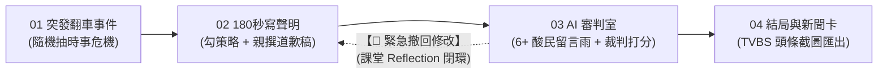

# 【期末專案發想提案】《炎上大作戰：危機公關 180 秒》

> **繳交標題**：`學號 系級 姓名 《炎上大作戰：危機公關 180 秒》`  
> *(請將學號、系級簡稱與姓名替換為個人真實資訊)*

---

## 一、 專案基本資訊與定位

* **專案名稱**：《炎上大作戰：危機公關 180 秒》（Firestorm PR: 180s Crisis Survival）
* **專案類型**：互動式危機公關文字模擬遊戲（結合 Vibe Coding、多智能體 Prompt 工程與 LLM API）
* **核心標語**：「百萬訂閱一夕歸零，今晚你是全身而退，還是被釘在公審恥辱柱上？」
* **部署架構**：純前端單檔（`index.html`）託管於 **GitHub Pages**，免租用後端伺服器，零維護成本。

---

## 二、 專案背景與核心動機（Why）

1. **時事痛點與社會話題性**：
   社群平台（Threads、Dcard、YouTube）時代，網紅人設崩塌與品牌公關危機頻傳。大部分公關聲明充斥「佔用社會資源」、「推託責任給外包」等千篇一律的官腔套話，不僅無法滅火，反而引爆全網二次炎上。
2. **為什麼非用「生成式 AI」不可（拒絕寫死劇本）**：
   傳統文字冒險遊戲只能透過固定選項跳轉預設結局，缺乏真實隨機感。本專案核心導入大語言模型（LLM），允許玩家在輸入框自由撰寫真實的公關澄清或道歉聲明，由 AI 即時進行深層語義剖析、邏輯漏洞挑錯，並動態模擬多樣化網友的辛辣吐槽與輿論走向。

---

## 三、 核心遊戲玩法與流程（What）

遊戲採單回合、3 分鐘一局的高節奏危機處置模擬，包含 **4 大遊戲階段** 與 **1 個 Reflection 閉環機制**：

### 1. 遊戲核心流程圖



### 2. 四大階段詳細規格

* **階段 1：突發危機爆料（Crisis Trigger / 0~10s）**
  * 螢幕閃爍紅色警報呼吸燈動畫，伴隨刺耳警報音效。
  * 由內建事件庫隨機抽取經典時事梗（如：自創潮牌被爆淘寶 39 元貼牌連簡體吊牌都沒剪、知性網紅劈腿 4 人借花獻佛、手搖飲珍珠掉水槽等）。
  * 亮出網友最關注的「三大核心質疑（必答題）」與初始數值：粉絲數 1,500,000、炎上度 75%（高危險）、廠商信任度 30%。
* **階段 2：180 秒緊急危機公關（PR Tactic & Drafting）**
  * 右上角 180 秒倒數計時器啟動，時限歸零視為「神隱逃避責任」直接暴斃。
  * **戰術標籤勾選**：影片形式（黑底白字嘆氣 / 憔悴素顏鞠躬 / 律師在旁）＋ 話術策略（全盤認錯退款 / 推給外包廠商 / 曬身心科病歷 / 保留法律追訴權）。
  * **親手撰寫聲明稿**：玩家在文字框輸入回應；詞窮時可點擊「AI 官腔小幫手」一鍵生成充滿套話的初稿再微調。
* **階段 3：AI 輿論審判室（AI Backfire Simulator）**
  * 點擊【發布聲明（聽天由命）】後進入動態演出：
  * **AI 1【網民大軍】**：右側深色卡片瀑布流以每 0.4 秒依序彈出 6 則以上鮮明立場的留言雨與點讚動效。
  * **AI 2【公關裁判長】**：挑出聲明漏洞，儀表板心電圖瘋狂跳動扣血（如：`-850,000` 粉絲），炎上指數直飆。
* **階段 4：終局命運與頭條圖卡（Outcome & Headline）**
  * 依據綜合數值判定 4 大極端結局：
    1. 【身敗名裂，徹底封殺】：掉粉超百萬，廠商解約求償，夜市擺攤。
    2. 【越描越黑，二度炎上】：漏洞百出，道歉文被剪成迷因鬼畜瘋傳。
    3. 【黑紅也是紅，轉型爭議巨星】：爭議破表，轉型狂暴系直播主靠斗內賺錢。
    4. 【教科書級公關滅火】：誠懇認錯退款，粉絲逆勢回流，公關業界神級範本。
  * **分享圖卡匯出**：HTML5 Canvas 自動繪製「蘋果 / TVBS 風格突發即時新聞頭條截圖」（突發紅標跑馬燈、大頭貼、AI 辛辣下標、掉粉統計），玩家可一鍵存檔分享至社群平台。

---

## 四、 生成式 AI 技術架構（How - 課堂理論緊扣）

本專案緊扣課堂簡報《08教AI做事的方法.pdf》中，吳恩達（Andrew Ng）提出的 4 大 AI Agent 設計模式，具體實踐 **Reflection（評論員模式）** 與 **Multi-Agent Collaboration（多智能體協同）**：

### 1. 雙 AI 智能體角色定位

| AI 角色 | 課堂理論對齊 | 職責與演出內容 |
| :--- | :--- | :--- |
| **AI 1：社群網民大軍** | **Multi-Agent 協同** | **感性與情緒演出**：模擬社群多樣化立場，強制輸出 6+ 種鮮明人設留言（顯微鏡柯南、激進黑粉、盲目死忠粉、昔日合作廠商、蹭流量八卦客、迷因製造機）。 |
| **AI 2：公關裁判長** | **Reflection（評論員 Critic）** | **理性與數值量化**：擔任專業審查評論員，執行兩階段思維鏈（CoT），挑出漏洞並映射為遊戲數據。 |

### 2. 公關裁判的內部思維鏈（CoT 兩階段）

1. **質化漏洞挑錯（Qualitative Analysis - Reflection 核心）**：
   * 逐句審查玩家聲明稿，抓出 2~3 個致命公關敗筆（例如：「第一段道歉虛應故事，第二段立刻將責任推卸給外包」、「未給予退款補償方案，避重就輕」）。
2. **客觀量化評估（Quantitative Mapping）**：
   * 根據漏洞嚴重度，客觀映射為遊戲數值：誠意評分（0~100）、甩鍋指數、扣粉數量、炎上指數增減、結局代碼。

### 3. 加分亮點：Human-in-the-loop Reflection 閉環

* **機制說明**：在傳統對話中往往只有單向審核；本遊戲提供「🚨 緊急撤回修改」按鈕。
* **閉環流程**：玩家在 180 秒內看見 AI 裁判的毒舌批改與掉粉慘況後，若點擊撤回，可**依據 AI 剛剛挑出的具體毛病修改聲明稿重新送審**。
* **學術意涵**：完美達成課堂中「作者產生初稿 $\rightarrow$ 評論員評估挑錯 $\rightarrow$ 作者吸收回饋修改重提」的完整 Reflection 閉環！

### 4. API 輸入與輸出（I/O）標準 JSON 規格

* **前端發送 Context（Input）**：
  ```json
  {
    "event_title": "自創潮牌驚爆淘寶貼牌",
    "core_inquiries": ["是否為淘寶同款", "是否全額退款", "為何刪除質疑留言"],
    "selected_tactics": ["黑底白字嘆氣", "推給外包廠商", "曬身心科病歷"],
    "player_statement": "對於佔用社會資源感到很抱歉...外包廠商把關不嚴..."
  }
  ```
* **AI 裁判回傳（Output JSON）**：
  ```json
  {
    "qualitative_analysis": {
      "attitude": "避重就輕，推卸責任",
      "critical_flaws": [
        "第一段道歉虛應故事，第二段立刻將品管責任推給外包廠商。",
        "完全無視買家的退款訴求，通篇未見任何賠償方案。"
      ],
      "expert_verdict": "典型提油救火的災難級公關稿，引爆全網二次公憤。"
    },
    "quantitative_scores": {
      "sincerity_score": 35,
      "shirking_index": 85,
      "fan_change": -850000,
      "flame_delta": 25,
      "ending_code": "ENDING_BACKFIRE",
      "breaking_news_headline": "【獨家】淘寶貼牌翻車！百萬網紅曬病歷喊告遭痛批：當全網是盤子？"
    }
  }
  ```

### 5. 系統防呆與展演保證

* **Markdown 標籤清洗**：前端用 Regex 自動去除 ````json 標籤，防止 `JSON.parse` 報錯閃退。
* **空白輸入判定**：若輸入空白或亂碼，硬性判定為「神隱裝死逃避」，炎上指數直接補滿 100% 暴斃。
* **離線智囊庫（Fallback Cache）**：內建預設留言庫與評分資料，若展演現場斷網或 API 限流，自動無縫切換離線展示模式，保證 100% 順暢不翻車。

---

## 五、 畫面佈局與實作部署規劃

1. **三欄式沉浸介面**：
   * **左側**：紅色警報動畫、180 秒倒數器、粉絲數暴跌心電圖曲線。
   * **中央**：公關策略勾選鈕、大輸入框、醒目的發布與撤回按鈕。
   * **右側**：仿 Threads / YouTube 深色卡片社群動態串流。
2. **部署於 GitHub Pages**：單一靜態網頁（`index.html`），任何人在手機或電腦瀏覽器點開即可試玩。
3. **金鑰安全保護**：右上角設計「⚙️ 設定」彈窗，使用者自行輸入 Groq / Gemini API Key 存於本地 `localStorage`，GitHub 原始碼完全公開且零洩漏風險。

---

## 六、 專案時程進度（Milestones）

* **第 09～10 週**：完成核心 System Prompt 調校，驗證 JSON 輸出穩定性與建立離線智囊庫。
* **第 11～12 週**：以 Vibe Coding 完成 `index.html` 單檔切版、倒數計時器與 Canvas 新聞圖卡繪製。
* **第 13～14 週**：完成 API 串接、留言瀑布流動態演出與 Human-in-the-loop 撤回修改機制。
* **第 15～16 週**：錄製 1～3 分鐘 Demo 影片、定稿 PDF 報告並參與成果展演。

---

## 七、 附件與圖檔參考

* 📊 **極簡版核心遊戲流程圖**：已生成於專案目錄 [`遊戲流程圖_簡潔版.png`](../assets/遊戲流程圖_簡潔版.png)
* 📊 **技術架構與 Reflection 資料流圖**：已生成於專案目錄 [`AI技術架構與Reflection流程圖.png`](../assets/AI技術架構與Reflection流程圖.png)
